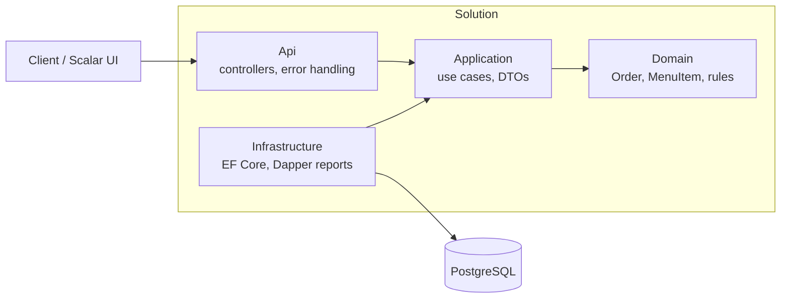

# Restaurant POS & Order Management API

A REST API for a restaurant point-of-sale: menu, table orders, kitchen hand-off, payment (cash/card, tax, discount, change) and sales reports. Built with **C# / .NET 9**, **PostgreSQL** and **EF Core**, with hand-written **SQL reports (window functions + CTEs)** through Dapper.

## Features

- **Menu**: create items, change price, mark available/unavailable, filter by category
- **Orders**: open an order for a table, add/remove lines, apply a discount, send to kitchen, pay, cancel
- **Payment**: card must match the total; cash must cover it and the change is calculated
- **Reports** (SQL): daily sales with running total, top-selling items ranked by revenue, sales by hour with share of total
- **Clear errors**: RFC 7807 `ProblemDetails` with proper status codes (404, 409, 422, 500)
- **45 automated tests**, including integration tests against a real PostgreSQL (Testcontainers)

## Architecture

Clean Architecture: dependencies point inwards, the domain knows nothing about the database or HTTP.



- **Commands** (write side) go through EF Core and the domain model, so every rule is enforced in one place (`Order`).
- **Queries and reports** (read side) project straight to DTOs or run plain SQL; they never load aggregates just to display them.

## Run it (Docker)

```bash
docker compose up -d --build
```

- API + Swagger-style UI (Scalar): http://localhost:5090/scalar/v1
- Health check: http://localhost:5090/health
- PostgreSQL is exposed on port 5434 (user `pos`, password `pos_pw`, local demo only)

The app applies its database migrations automatically on startup.

Optional: add synthetic demo sales so the reports have data (about 300 made-up paid orders over 14 days):

```bash
docker compose exec -T db psql -U pos -d restaurant < scripts/seed-demo-data.sql
```

Then try, for India time: `GET /reports/daily-sales?utcOffsetMinutes=330`

## API overview

| Method | Path | What it does |
|---|---|---|
| GET / POST | `/menu` | List (optional `?category=`) / create a menu item |
| GET | `/menu/{id}` | One menu item |
| PUT | `/menu/{id}/price` | Change price |
| PUT | `/menu/{id}/availability` | Mark available / unavailable |
| POST | `/orders` | Open an order for a table |
| GET | `/orders`, `/orders/{id}` | Active orders / one order with totals |
| POST | `/orders/{id}/lines` | Add an item (same item merges, quantity 1 to 99) |
| DELETE | `/orders/{id}/lines/{menuItemId}` | Remove an item |
| PUT | `/orders/{id}/discount` | Discount 0 to 100 percent |
| POST | `/orders/{id}/send` | Send to kitchen (locks the order) |
| POST | `/orders/{id}/pay` | Pay with Cash or Card |
| POST | `/orders/{id}/cancel` | Cancel with a reason |
| GET | `/reports/daily-sales` | Orders, gross, discount, tax, total, average, running total per day |
| GET | `/reports/top-items` | Items ranked by revenue (`RANK()`), with percentage share |
| GET | `/reports/sales-by-hour` | Sales per hour of day with share of total |

Reports take `fromDate`, `toDate` (default: last 30 days) and `utcOffsetMinutes` (for example `330` for India) so sales fall into the restaurant's local day and hour.

## Design decisions

- **Money is integer cents** (`long`), tax in **basis points** (500 = 5%). Rounding is half-up using integer maths only, so there are no floating-point errors. The SQL reports use the same formulas as the C# code, and the tests check that they agree.
- **One active order per table** is enforced by the database with a **partial unique index** (`status IN ('Open','SentToKitchen')`), not only in code, so two waiters can't open the same table at the same time.
- **Optimistic concurrency** with PostgreSQL's `xmin`: if two people change the same order at once, the second gets a **409** instead of silently overwriting.
- **Price snapshot**: an order line stores the item name and price at the time of sale, so changing the menu later never alters old orders or reports.
- **Business rules live in the domain**: you can't pay an empty order, add items after it was sent, or pay less than the total in cash. These return **422**.
- **Hand-written SQL for reports**: aggregates with window functions (`RANK() OVER`, running `SUM() OVER`, share of total) are clearer and faster as SQL than as LINQ.
- `TimeProvider` is injected, so time-dependent logic can be tested.

## Tests

```bash
dotnet test
```

45 tests (Docker must be running for the integration tests):

- **32 unit tests** for the domain: totals, rounding, discount, payment, state rules
- **13 integration tests** that start a real PostgreSQL 16 in Docker (Testcontainers) and call the API: the full open, add, send, pay flow, the 404 / 409 / 422 error cases, table reuse after payment, and the three reports checked against **hand-calculated numbers**, including the UTC offset moving a sale into the next local day

## Project layout

```
src/
  RestaurantPos.Domain          entities and business rules
  RestaurantPos.Application     use cases, DTOs, interfaces
  RestaurantPos.Infrastructure  EF Core, migrations, Dapper reports
  RestaurantPos.Api             controllers, error handling, Program.cs
tests/RestaurantPos.Tests       unit + integration tests
scripts/seed-demo-data.sql      synthetic demo data
```

## Limitations

- No authentication or user roles yet (a real POS would need staff login and permissions).
- Payment records what was tendered; it does not talk to a real card processor.
- One restaurant and one flat tax rate (from configuration).
- Demo data in `scripts/seed-demo-data.sql` is synthetic.
